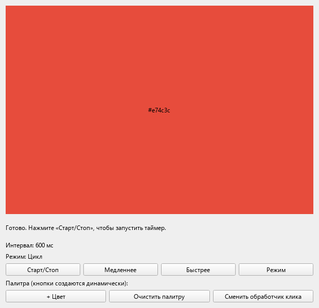
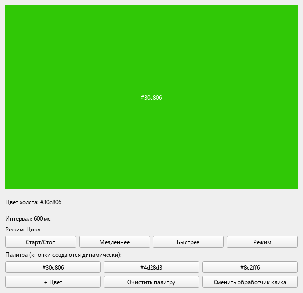
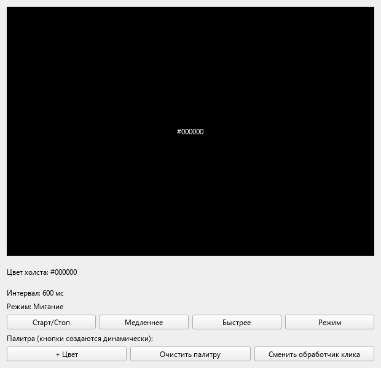

# Лабораторная работа № 3

**Дисциплина:** Основы кроссплатформенного программирования<br>
**Тема:** QTimer, лямбда-слоты и динамические соединения<br>
**Выполнил:** Кудаев Максим Сергеевич<br>
**Группа:** ПИЖ-б-о-24-1<br>
**Дата:** 28 октября 2026 года<br>
**Репозиторий:** [SETAVR/ColorSwitcher](https://github.com/SETAVR/ColorSwitcher)

## Цель работы

Освоить класс QTimer для периодического и однократного выполнения кода, научиться использовать лямбда-функции в качестве слотов с корректным захватом и контекстом подключения, а также создавать, разрывать и переподключать соединения между сигналами и слотами динамически, во время выполнения программы. На практике закрепить это на приложении, которое переключает цвет фона по таймеру, реагирует на нажатия мыши и позволяет добавлять и удалять обработчики на лету.

## Постановка задачи

Разработать приложение **ColorSwitcher** на Qt Widgets с программным построением интерфейса без файла `.ui`:

1. Переключать цвет холста с помощью QTimer в режимах «Цикл», «Случайный», «Мигание».
2. Управлять запуском, остановкой и интервалом таймера; продемонстрировать однократный вызов singleShot.
3. Использовать лямбда-слоты с безопасным захватом и объектом-контекстом.
4. Создавать кнопки цветов во время выполнения и подключать их сигналы динамически.
5. Хранить QMetaObject::Connection и разрывать соединения перед удалением кнопок.
6. Обрабатывать левый и правый клики через mousePressEvent и излучать собственный colorChanged.
7. Переключать обработчик colorChanged между строкой статуса и заголовком окна без пересоздания отправителя.
8. Разобрать различия ошибок компиляции и линковки.

## Теоретическое обоснование

QTimer излучает `timeout()` после заданного интервала. `start()` использует текущий интервал, а `start(ms)` задаёт новый и запускает таймер. Оба варианта по умолчанию запускают **повторяющийся** таймер. Однократный вызов задаётся `setSingleShot(true)` либо статическим `QTimer::singleShot()`.

Таймер работает через цикл событий: пока основной поток занят блокирующей операцией, обработка timeout задерживается. `QApplication::exec()` обслуживает таймеры, ввод мыши, перерисовку и отложенное удаление. Интервал указывается в миллисекундах; фактическое время срабатывания зависит от типа таймера и загрузки системы.

Лямбда-слот хранит захваченные значения. `[color]` копирует цвет, `[this]` сохраняет указатель на окно, а `[&]` создаёт ссылки на внешние переменные. Захват локальной переменной по ссылке опасен, если она уничтожится до вызова обработчика. В соединениях приложения передан контекст `this`, поэтому Qt отключает лямбды при уничтожении окна.

`connect()` возвращает `QMetaObject::Connection`. Приложение хранит это значение и вызывает `disconnect(connection)` перед установкой нового обработчика. Так смена режима не накапливает несколько вызовов на один timeout. Для лямбд `Qt::UniqueConnection` не обеспечивает устранение дубликатов, поэтому здесь применяется явное отключение.

`mousePressEvent()` является виртуальным обработчиком события, а `colorChanged()` — сигналом. Холст обрабатывает ЛКМ/ПКМ, меняет индекс палитры и излучает сигнал; главное окно реагирует через выбранную лямбду. Режим мигания хранит фазу в поле холста и чередует текущий цвет с чёрным одним таймером.

Метаобъектная система Qt и макрос `Q_OBJECT` обеспечивают собственные сигналы и слоты. MOC генерирует необходимый код, а qmake включает его в сборку. Объявления находятся в `.h`, определения методов — в соответствующих `.cpp`.

## Сборка и запуск

Откройте `ColorSwitcher.pro` в Qt Creator, выберите Desktop kit и выполните сборку и запуск. Требуются Qt Widgets и компилятор с поддержкой C++17. Диагностика выводится в Application Output.

В терминале выбранного Qt-комплекта из корня проекта:

```sh
mkdir build
cd build
qmake ../ColorSwitcher.pro
make
./ColorSwitcher
```

В Windows для MinGW вместо `make` используется `mingw32-make`, для MSVC — `nmake` в Developer Command Prompt. При release-сборке MSVC приложение находится в `build/release/ColorSwitcher.exe`; для запуска вне Qt Creator каталог `bin` выбранного Qt должен быть в `PATH`.

## Листинг кода с комментариями

<details>
<summary>ColorSwitcher.pro</summary>

```qmake
QT += widgets
CONFIG += c++17 console
CONFIG -= app_bundle
TARGET = ColorSwitcher
TEMPLATE = app

SOURCES += main.cpp colorwidget.cpp palettebutton.cpp mainwindow.cpp
HEADERS += colorwidget.h palettebutton.h mainwindow.h

msvc:QMAKE_CXXFLAGS += /utf-8
```

</details>

<details>
<summary>colorwidget.h</summary>

```cpp
#ifndef COLORWIDGET_H
#define COLORWIDGET_H

#include <QColor>
#include <QVector>
#include <QWidget>

class ColorWidget : public QWidget
{
    Q_OBJECT
public:
    explicit ColorWidget(QWidget *parent = nullptr);
    ~ColorWidget() override;
    void addColor(const QColor &color);
    void resetPalette();
    QColor currentColor() const;
    void stepForward();
    void stepBackward();
    void setRandomColor();
    void toggleBlink();
    void stopBlink();

signals:
    void colorChanged(const QColor &color);

protected:
    void paintEvent(QPaintEvent *event) override;
    void mousePressEvent(QMouseEvent *event) override;

private:
    static QVector<QColor> defaultPalette();
    void emitCurrent();
    QVector<QColor> m_palette;
    int m_index = 0;
    bool m_blinkOn = false;
};

#endif
```

</details>

<details>
<summary>colorwidget.cpp</summary>

```cpp
#include "colorwidget.h"

#include <QDebug>
#include <QMouseEvent>
#include <QPainter>
#include <QRandomGenerator>

ColorWidget::ColorWidget(QWidget *parent)
    : QWidget(parent), m_palette(defaultPalette())
{
    setObjectName("canvas");
    setMinimumSize(320, 220);
    qDebug() << "[CREATE] ColorWidget, palette:" << m_palette.size();
}

ColorWidget::~ColorWidget()
{
    qDebug() << "[DESTROY] ColorWidget";
}

QVector<QColor> ColorWidget::defaultPalette()
{
    return {QColor("#e74c3c"), QColor("#e67e22"), QColor("#f1c40f"),
            QColor("#2ecc71"), QColor("#3498db"), QColor("#9b59b6")};
}

QColor ColorWidget::currentColor() const
{
    // The signal and log must describe the displayed colour, including black.
    if (m_blinkOn)
        return QColor(Qt::black);
    return m_palette.isEmpty() ? QColor(Qt::gray) : m_palette.at(m_index);
}

void ColorWidget::addColor(const QColor &color)
{
    if (!color.isValid())
        return;
    m_palette.append(color);
    qDebug() << "[PALETTE] Added" << color.name() << "total:" << m_palette.size();
}

void ColorWidget::resetPalette()
{
    m_palette = defaultPalette();
    m_index = 0;
    m_blinkOn = false;
    emitCurrent();
}

void ColorWidget::stepForward()
{
    if (m_palette.isEmpty()) return;
    m_index = (m_index + 1) % int(m_palette.size());
    m_blinkOn = false;
    emitCurrent();
}

void ColorWidget::stepBackward()
{
    if (m_palette.isEmpty()) return;
    m_index = (m_index - 1 + int(m_palette.size())) % int(m_palette.size());
    m_blinkOn = false;
    emitCurrent();
}

void ColorWidget::setRandomColor()
{
    if (m_palette.isEmpty()) return;
    m_index = QRandomGenerator::global()->bounded(int(m_palette.size()));
    m_blinkOn = false;
    emitCurrent();
}

void ColorWidget::toggleBlink()
{
    m_blinkOn = !m_blinkOn;
    emitCurrent();
}

void ColorWidget::stopBlink()
{
    if (m_blinkOn) {
        m_blinkOn = false;
        emitCurrent();
    }
}

void ColorWidget::emitCurrent()
{
    update();
    emit colorChanged(currentColor());
}

void ColorWidget::paintEvent(QPaintEvent *)
{
    QPainter painter(this);
    const QColor color = currentColor();
    painter.fillRect(rect(), color);
    painter.setPen(color.lightness() > 128 ? Qt::black : Qt::white);
    painter.drawText(rect(), Qt::AlignCenter, color.name());
}

void ColorWidget::mousePressEvent(QMouseEvent *event)
{
    if (event->button() == Qt::LeftButton) {
        qDebug() << "[MOUSE] Left click";
        stepForward();
    } else if (event->button() == Qt::RightButton) {
        qDebug() << "[MOUSE] Right click";
        stepBackward();
    } else {
        QWidget::mousePressEvent(event);
        return;
    }
    event->accept();
}
```

</details>

<details>
<summary>palettebutton.h</summary>

```cpp
#ifndef PALETTEBUTTON_H
#define PALETTEBUTTON_H

#include <QColor>
#include <QPushButton>

class PaletteButton : public QPushButton
{
    Q_OBJECT
public:
    explicit PaletteButton(const QColor &color, QWidget *parent = nullptr);
    ~PaletteButton() override;
    QColor color() const { return m_color; }

private:
    QColor m_color;
};

#endif
```

</details>

<details>
<summary>palettebutton.cpp</summary>

```cpp
#include "palettebutton.h"

#include <QDebug>

PaletteButton::PaletteButton(const QColor &color, QWidget *parent)
    : QPushButton(parent), m_color(color)
{
    setText(color.name());
    setToolTip(QStringLiteral("Добавить этот цвет в палитру холста"));
    qDebug() << "[CREATE] PaletteButton" << color.name();
}

PaletteButton::~PaletteButton()
{
    qDebug() << "[DESTROY] PaletteButton" << m_color.name();
}
```

</details>

<details>
<summary>mainwindow.h</summary>

```cpp
#ifndef MAINWINDOW_H
#define MAINWINDOW_H

#include <QMetaObject>
#include <QPointer>
#include <QTimer>
#include <QWidget>
#include "colorwidget.h"
#include "palettebutton.h"

class QLabel;
class QGridLayout;

class MainWindow : public QWidget
{
    Q_OBJECT
public:
    explicit MainWindow(QWidget *parent = nullptr);
    ~MainWindow() override;

private slots:
    void toggleTimer();
    void decreaseInterval();
    void increaseInterval();
    void cycleMode();
    void addColorButton();
    void clearPaletteButtons();
    void toggleClickHandler();

private:
    enum class Mode { Cycle, Random, Blink };
    void setupUi();
    void rebuildTimeoutConnection();
    void reconnectCanvasHandler();
    void setStatus(const QString &text);
    void updateIntervalLabel();
    void updateModeLabel();
    QString modeName() const;

    QTimer m_timer;
    ColorWidget m_canvas;
    Mode m_mode = Mode::Cycle;
    bool m_clickHandlerAlt = false;
    QMetaObject::Connection m_timeoutConn;
    QMetaObject::Connection m_clickConn;
    QGridLayout *m_paletteGrid = nullptr;
    QLabel *m_statusLabel = nullptr;
    QLabel *m_intervalLabel = nullptr;
    QLabel *m_modeLabel = nullptr;
    QList<QPointer<PaletteButton>> m_paletteButtons;
    QList<QMetaObject::Connection> m_dynamicConnections;
};

#endif
```

</details>

<details>
<summary>mainwindow.cpp</summary>

```cpp
#include "mainwindow.h"

#include <QDebug>
#include <QGridLayout>
#include <QHBoxLayout>
#include <QLabel>
#include <QPushButton>
#include <QRandomGenerator>
#include <QVBoxLayout>

MainWindow::MainWindow(QWidget *parent) : QWidget(parent)
{
    m_timer.setParent(this);
    m_timer.setObjectName("timer");
    m_timer.setInterval(600);
    setupUi();
    rebuildTimeoutConnection();
    reconnectCanvasHandler();
    // A one-shot callback with a context: cancelled if the window is destroyed.
    QTimer::singleShot(0, this, [this] {
        setStatus(QStringLiteral("Готово. Нажмите «Старт/Стоп», чтобы запустить таймер."));
        qDebug() << "[ONCE] Initial status";
    });
}

MainWindow::~MainWindow()
{
    m_timer.stop();
    qDebug() << "[DESTROY] MainWindow";
}

void MainWindow::setupUi()
{
    setWindowTitle(QStringLiteral("ColorSwitcher — QTimer и динамические соединения"));
    resize(620, 600);
    auto *root = new QVBoxLayout(this);
    m_canvas.setParent(this);
    root->addWidget(&m_canvas, 1);
    m_statusLabel = new QLabel(this);
    m_statusLabel->setObjectName("status");
    m_statusLabel->setWordWrap(true);
    m_statusLabel->setMinimumHeight(40);
    root->addWidget(m_statusLabel);
    m_intervalLabel = new QLabel(this);
    m_intervalLabel->setObjectName("interval");
    m_modeLabel = new QLabel(this);
    m_modeLabel->setObjectName("mode");
    root->addWidget(m_intervalLabel);
    root->addWidget(m_modeLabel);

    auto *controls = new QHBoxLayout;
    auto *start = new QPushButton(QStringLiteral("Старт/Стоп"), this);
    start->setObjectName("start");
    auto *slow = new QPushButton(QStringLiteral("Медленнее"), this);
    slow->setObjectName("slow");
    auto *fast = new QPushButton(QStringLiteral("Быстрее"), this);
    fast->setObjectName("fast");
    auto *mode = new QPushButton(QStringLiteral("Режим"), this);
    mode->setObjectName("modeButton");
    for (auto *button : {start, slow, fast, mode}) controls->addWidget(button);
    root->addLayout(controls);
    connect(start, &QPushButton::clicked, this, &MainWindow::toggleTimer);
    connect(slow, &QPushButton::clicked, this, &MainWindow::decreaseInterval);
    connect(fast, &QPushButton::clicked, this, &MainWindow::increaseInterval);
    connect(mode, &QPushButton::clicked, this, &MainWindow::cycleMode);

    root->addWidget(new QLabel(QStringLiteral("Палитра (кнопки создаются динамически):"), this));
    m_paletteGrid = new QGridLayout;
    root->addLayout(m_paletteGrid);
    auto *paletteControls = new QHBoxLayout;
    auto *add = new QPushButton(QStringLiteral("+ Цвет"), this);
    add->setObjectName("add");
    auto *clear = new QPushButton(QStringLiteral("Очистить палитру"), this);
    clear->setObjectName("clear");
    auto *handler = new QPushButton(QStringLiteral("Сменить обработчик клика"), this);
    handler->setObjectName("handler");
    for (auto *button : {add, clear, handler}) paletteControls->addWidget(button);
    root->addLayout(paletteControls);
    connect(add, &QPushButton::clicked, this, &MainWindow::addColorButton);
    connect(clear, &QPushButton::clicked, this, &MainWindow::clearPaletteButtons);
    connect(handler, &QPushButton::clicked, this, &MainWindow::toggleClickHandler);
    updateIntervalLabel();
    updateModeLabel();
}

void MainWindow::setStatus(const QString &text)
{
    m_statusLabel->setText(text);
}

void MainWindow::updateIntervalLabel()
{
    m_intervalLabel->setText(QStringLiteral("Интервал: %1 мс").arg(m_timer.interval()));
}

void MainWindow::updateModeLabel()
{
    m_modeLabel->setText(QStringLiteral("Режим: %1").arg(modeName()));
}

QString MainWindow::modeName() const
{
    switch (m_mode) {
    case Mode::Cycle: return QStringLiteral("Цикл");
    case Mode::Random: return QStringLiteral("Случайный");
    case Mode::Blink: return QStringLiteral("Мигание");
    }
    return {};
}

void MainWindow::toggleTimer()
{
    if (m_timer.isActive()) {
        m_timer.stop();
        setStatus(QStringLiteral("Таймер остановлен."));
        qDebug() << "[TIMER] stop()";
    } else {
        m_timer.start();
        setStatus(QStringLiteral("Таймер запущен (интервал %1 мс).").arg(m_timer.interval()));
        qDebug() << "[TIMER] start(), interval =" << m_timer.interval();
    }
}

void MainWindow::decreaseInterval()
{
    m_timer.setInterval(qMin(m_timer.interval() + 200, 5000));
    updateIntervalLabel();
    qDebug() << "[TIMER] interval ->" << m_timer.interval();
}

void MainWindow::increaseInterval()
{
    m_timer.setInterval(qMax(m_timer.interval() - 200, 50));
    updateIntervalLabel();
    qDebug() << "[TIMER] interval ->" << m_timer.interval();
}

void MainWindow::cycleMode()
{
    m_canvas.stopBlink();
    switch (m_mode) {
    case Mode::Cycle: m_mode = Mode::Random; break;
    case Mode::Random: m_mode = Mode::Blink; break;
    case Mode::Blink: m_mode = Mode::Cycle; break;
    }
    updateModeLabel();
    rebuildTimeoutConnection();
    setStatus(QStringLiteral("Режим переключён: %1").arg(modeName()));
    qDebug() << "[TIMER] mode ->" << modeName() << "(reconnected timeout)";
}

void MainWindow::rebuildTimeoutConnection()
{
    // Keep only one timeout handler; UniqueConnection does not deduplicate lambdas.
    if (m_timeoutConn) disconnect(m_timeoutConn);
    m_timeoutConn = connect(&m_timer, &QTimer::timeout, this, [this] {
        switch (m_mode) {
        case Mode::Cycle: m_canvas.stepForward(); break;
        case Mode::Random: m_canvas.setRandomColor(); break;
        case Mode::Blink: m_canvas.toggleBlink(); break;
        }
        qDebug() << "[TIMER] timeout, mode =" << modeName()
                 << "color =" << m_canvas.currentColor().name();
    });
}

void MainWindow::reconnectCanvasHandler()
{
    if (m_clickConn) disconnect(m_clickConn);
    if (!m_clickHandlerAlt) {
        m_clickConn = connect(&m_canvas, &ColorWidget::colorChanged, this, [this](const QColor &color) {
            setStatus(QStringLiteral("Цвет холста: %1").arg(color.name()));
        });
    } else {
        m_clickConn = connect(&m_canvas, &ColorWidget::colorChanged, this, [this](const QColor &color) {
            setWindowTitle(QStringLiteral("ColorSwitcher — %1").arg(color.name()));
        });
    }
}

void MainWindow::toggleClickHandler()
{
    m_clickHandlerAlt = !m_clickHandlerAlt;
    reconnectCanvasHandler();
    setStatus(m_clickHandlerAlt ? QStringLiteral("Обработчик Б: заголовок окна.")
                               : QStringLiteral("Обработчик А: строка статуса."));
    qDebug() << "[CANVAS] Reconnected colorChanged, alternative =" << m_clickHandlerAlt;
}

void MainWindow::addColorButton()
{
    const QColor color = QColor::fromHsv(QRandomGenerator::global()->bounded(360),
                                        200 + QRandomGenerator::global()->bounded(55),
                                        200 + QRandomGenerator::global()->bounded(55));
    auto *button = new PaletteButton(color, this);
    const int index = int(m_paletteButtons.size());
    m_paletteGrid->addWidget(button, index / 4, index % 4);
    // Capture the colour by value; the lambda never dereferences a button pointer.
    const auto connection = connect(button, &QPushButton::clicked, this, [this, color] {
        m_canvas.addColor(color);
        setStatus(QStringLiteral("Добавлен цвет %1 в палитру холста.").arg(color.name()));
        qDebug() << "[DYNAMIC] Clicked colour button" << color.name();
    });
    m_paletteButtons.append(QPointer<PaletteButton>(button));
    m_dynamicConnections.append(connection);
    setStatus(QStringLiteral("Создана кнопка-цвет %1.").arg(color.name()));
    qDebug() << "[DYNAMIC] Connected" << color.name() << "total:" << m_dynamicConnections.size();
}

void MainWindow::clearPaletteButtons()
{
    const int count = int(m_dynamicConnections.size());
    for (const auto &connection : m_dynamicConnections) disconnect(connection);
    m_dynamicConnections.clear();
    for (const auto &button : m_paletteButtons) {
        if (button) {
            m_paletteGrid->removeWidget(button.data());
            button->hide();
            button->deleteLater();
        }
    }
    m_paletteButtons.clear();
    m_canvas.resetPalette();
    setStatus(QStringLiteral("Палитра очищена: соединения разорваны, кнопки удалены."));
    qDebug() << "[DYNAMIC] Cleared palette, disconnected:" << count;
}
```

</details>

<details>
<summary>main.cpp</summary>

```cpp
#include <QApplication>
#include "mainwindow.h"

int main(int argc, char *argv[])
{
    QApplication app(argc, argv);
    MainWindow window;
    window.show();
    return app.exec();
}
```

</details>

## Пример работы программы

Сборка и проверка выполнены с Qt 6.8.3 и MSVC x64 на Windows 10. Проверены сценарии ниже; фактический журнал находится в [docs/session.txt](docs/session.txt).

| № | Действие | Результат |
| --- | --- | --- |
| 1 | Запустить приложение | Холст красный, интервал 600 мс, режим «Цикл», таймер остановлен; singleShot задаёт начальный статус |
| 2 | Нажать «Старт/Стоп» | Начинается периодическое изменение цвета; повторное нажатие останавливает таймер |
| 3 | Нажимать «Быстрее» и «Медленнее» | Интервал меняется на 200 мс в пределах 50–5000 мс, подпись обновляется |
| 4 | Нажать «Режим» | «Цикл» сменяется на «Случайный», затем «Мигание» и снова «Цикл»; соединение timeout пересоздаётся |
| 5 | Проверить «Мигание» | Холст чередует текущий цвет с чёрным; сигнал и журнал сообщают отображаемый цвет |
| 6 | Нажать ЛКМ и ПКМ на холсте | Выбираются следующий и предыдущий цвета; из обработчика события излучается colorChanged |
| 7 | Трижды нажать «+ Цвет», затем одну из новых кнопок | Создаются три динамические кнопки; выбранный цвет добавляется в палитру холста |
| 8 | Нажать «Очистить палитру» | Соединения отключаются, кнопки удаляются через deleteLater, базовая палитра восстанавливается |
| 9 | Нажать «Сменить обработчик клика» | Изменение цвета обновляет заголовок вместо статуса; повторное нажатие возвращает обработчик статуса |
| 10 | Многократно переключить режим, затем вызвать один timeout | Выполняется один обработчик, дублирующих соединений нет |

**Начальное окно:**



**Динамические кнопки и добавленный цвет:**



**Чёрная фаза мигания:**



## Разбор ошибок и их решений

### 1. Несовпадение цвета холста и сигнала при мигании

В примере методички `paintEvent()` рисует чёрный цвет отдельно, а `currentColor()` продолжает возвращать цвет палитры. Поэтому журнал и обработчик сигнала не отражают чёрную фазу. В реализации `currentColor()` учитывает фазу мигания; рисование и `colorChanged()` используют один источник цвета. При выходе из режима чёрная фаза сбрасывается.

### 2. Неверная начальная подпись интервала

В примере начальная подпись обновляется в `setupUi()` до вызова `setInterval(600)`. В результате подпись может показывать 0 мс, хотя таймер затем настроен на 600 мс. Интервал установлен до создания интерфейса; проверено, что начальная подпись равна «Интервал: 600 мс».

### 3. Повторные обработчики при смене режима

Повторный `connect()` без отключения предыдущего соединения приводит к нескольким действиям за один тик. В `rebuildTimeoutConnection()` и `reconnectCanvasHandler()` сначала отключается сохранённое соединение. Проверка после 30 смен режима подтвердила один сигнал изменения цвета на один timeout.

### Различия ошибок сборки

| Сообщение | Этап | Причина и исправление |
| --- | --- | --- |
| `not declared in this scope`, MSVC `C3861` | Компиляция | Нет объявления используемого метода; добавить объявление в класс и проверить заголовки |
| `undefined reference`, MSVC `LNK2019` | Линковка | Нет определения вызываемого метода; проверить реализацию с `Класс::` и наличие `.cpp` в SOURCES |
| `multiple definition`, MSVC `LNK2005` | Линковка | Несколько определений одного символа; оставить одно определение в `.cpp`, корректно использовать inline |

В `ColorSwitcher.pro` перечислены все четыре `.cpp`. При изменении списка файлов следует заново выполнить qmake и пересобрать проект.

## Вывод

Разработано приложение, демонстрирующее периодический QTimer, однократный singleShot, безопасные лямбда-слоты, обработку мыши и динамическое управление соединениями. Освоены хранение QMetaObject::Connection, явное отключение перед переподключением и удаление динамических виджетов. Основные сложности — согласование состояния мигания с сигналом цвета и предотвращение повторных обработчиков. Оба случая проверены; неразобранных вопросов по выполненной части не осталось.

## Контрольные вопросы и ответы

### 1. Что такое QTimer и какой сигнал он излучает по истечении интервала?

QTimer — класс таймера Qt. При срабатывании он излучает сигнал `timeout()`.

### 2. Чем start() отличается от start(ms) и от QTimer::singleShot()?

`start()` запускает таймер с текущим интервалом; `start(ms)` дополнительно устанавливает интервал. По умолчанию оба запускают повторяющийся таймер, а не однократный. Статический `singleShot(ms, context, handler)` планирует один вызов обработчика без отдельного пользовательского объекта QTimer.

### 3. Почему QTimer не работает без app.exec()? Что такое цикл событий?

Срабатывание таймера доставляется через обработку событий его потока. Цикл событий получает события и вызывает соответствующие обработчики; в основном потоке приложения его запускает `app.exec()`.

### 4. Чем GUI-приложение с таймером принципиально отличается от консольного калькулятора ЛР1, где exec() не вызывался?

Исходный калькулятор выполнял команды синхронно в блокирующем цикле чтения. GUI должен обрабатывать ввод, таймеры и перерисовку через цикл событий. В дополненной версии первой работы с фоновым факториалом цикл событий также уже используется.

### 5. Что произойдёт, если лямбда-слот захватывает this, но контекст подключения не передан?

Если отправитель переживёт объект `this`, соединение может вызвать лямбду с недействительным указателем. Сам захват this не отслеживает время жизни объекта. Нужно передать соответствующий контекст в connect.

### 6. Зачем третий аргумент connect() (context object) и как он связан с деревом объектов ЛР2?

Контекст связывает время жизни лямбды с QObject и определяет поток queued-доставки. При уничтожении контекста соединение отключается. Если контекст является дочерним объектом, его удаление вместе с родителем также приводит к отключению.

### 7. Чем захват [=] отличается от [&]? Когда [&] опасен?

`[=]` копирует используемые внешние значения, `[&]` захватывает их по ссылке. Ссылки опасны, если отложенный обработчик переживает соответствующие переменные. Копирование указателя не продлевает время жизни объекта, на который он указывает.

### 8. Что такое QMetaObject::Connection и как разорвать соединение по нему?

Это дескриптор соединения, возвращаемый connect. Его сохраняют и передают в `QObject::disconnect(connection)`. Уничтожение самого дескриптора не отключает соединение.

### 9. Что такое Qt::UniqueConnection и какую проблему решает?

Это флаг, запрещающий повторное одинаковое соединение с методом объекта. Он не поддерживает устранение дубликатов для лямбд и произвольных функторов. Поэтому в работе перед новым подключением явно отключается прежний дескриптор.

### 10. Что будет, если вызвать одинаковый connect() дважды на одних объектах?

Обычно создадутся два соединения, и обработчик выполнится дважды на один сигнал. Для управляемой смены поведения нужно отключать старое соединение.

### 11. Рвёт ли Qt соединения автоматически при удалении отправителя, получателя или контекста?

Да. Соединения отключаются при уничтожении участвующих QObject. Для лямбды контекст нужно явно передать, если её время жизни должно быть ограничено этим объектом.

### 12. Почему для удаления динамической кнопки лучше deleteLater(), чем delete?

Отложенное удаление позволяет завершить текущую обработку события и вызовы обработчиков до уничтожения объекта. Это удобно, если удаление запрошено из сигнала кнопки или другого обработчика интерфейса.

### 13. Чем mousePressEvent() отличается от сигнала clicked()? Можно ли подключиться к событию через connect()?

`mousePressEvent()` — виртуальный метод обработки низкоуровневого события. `clicked()` — сигнал о высокоуровневом действии кнопки. Напрямую подключиться к обработчику события через connect нельзя; внутри него можно излучить собственный сигнал.

### 14. Что такое eventFilter() и когда он удобнее переопределения виртуального метода?

Фильтр событий — метод объекта-наблюдателя, который перехватывает события другого объекта после installEventFilter. Он удобен, когда нужно наблюдать несколько существующих объектов без создания отдельного подкласса для каждого.

### 15. Как реализовать мигание одним таймером без второго таймера?

Хранить логическую фазу и переключать её на каждом timeout. Одна фаза показывает выбранный цвет, другая — чёрный. Индекс исходного цвета при этом не меняется.

### 16. Что произойдёт, если менять interval() у активного таймера?

Изменение через setInterval перезапускает активный таймер с новым интервалом. Следующее срабатывание планируется относительно новой настройки; идентификатор таймера меняется.

### 17. Почему состояние режима хранится в поле m_mode, а не захватывается в лямбду?

Поле содержит актуальное состояние окна. Лямбда с `[this]` читает его при вызове; копия режима, захваченная при подключении, могла бы устареть после переключения.

### 18. Как проверить срабатывание timeout в юнит-тесте без реального ожидания?

Для проверки подключённой логики можно вызвать сигнал через `QMetaObject::invokeMethod(timer, "timeout", Qt::DirectConnection)` и проверить эффект или QSignalSpy. Это проверяет обработчики, но не планирование таймера. Фактическое срабатывание таймера проверяется отдельно с обработкой событий и ограниченным ожиданием.

### 19. Можно ли использовать QTimer в потоке без цикла событий? Что для этого нужно?

Без работающей обработки событий сигналы таймера не доставляются. В рабочем потоке нужно запустить цикл событий, например QThread::exec(), и запускать и останавливать QTimer в его собственном потоке.

### 20. Как динамические соединения связаны с автоудалением детей из ЛР2 при очистке палитры?

Кнопки создаются с родителем — главным окном, поэтому оно владеет ими. При их удалении Qt автоматически отключит соединения. При очистке программа дополнительно демонстрирует явный disconnect, затем вызывает deleteLater; QPointer обнуляется после фактического удаления.

### 21. Чем сообщение компилятора not declared in this scope отличается от сообщения линкера undefined reference и как по-разному чинить каждый?

Первое означает, что компилятор не видит подходящего объявления; нужно проверить заголовки и объявление метода в классе. Второе означает, что линкер не нашёл определение используемого символа; нужно проверить тело метода, его сигнатуру и включение `.cpp` в сборку.

### 22. Почему multiple definition возникает, когда тело метода есть и в .h, и в .cpp, и как это исправить?

Линкер выдаёт такую ошибку, когда в нескольких объектных файлах есть недопустимые повторные определения одного символа. Например, не-inline тело из заголовка попало в несколько единиц трансляции. Если два тела видны в одной единице трансляции, ошибка повторного определения возможна ещё на компиляции. Обычно в `.h` оставляют объявление, а единственное тело — в `.cpp`; методы внутри класса неявно inline.

### 23. Если компиляция прошла без ошибок, но линковка падает на undefined reference по всем слотам класса — где искать причину и почему это не MOC?

Сначала нужно проверить, что файл реализации класса входит в SOURCES и содержит определения с правильным префиксом `Класс::`, а не копию объявлений из заголовка. Ссылки из сгенерированного moc-файла на обычные методы показывают, что MOC уже отработал. Ошибки метаобъекта и vtable отдельно требуют проверки Q_OBJECT и генерации MOC; одно сообщение линкера само по себе не исключает все проблемы MOC.
